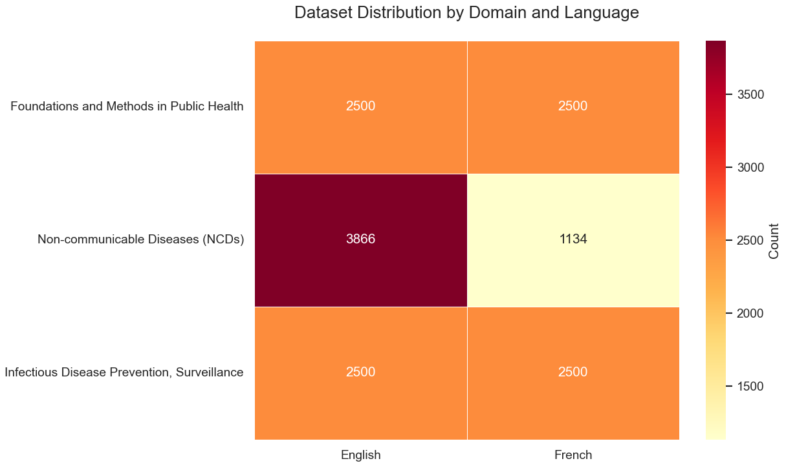

# OmniHealth-DB

[Hugging Face dataset](https://huggingface.co/datasets/ZhaokunYan/OmniHealth-DB) · [Scientific Data article](https://doi.org/10.1038/s41597-026-08596-z) · [Dataset DOI](https://doi.org/10.57967/hf/10828)

OmniHealth-DB is a bilingual public-health dataset with **15,000 examples** in English and French. Its three subsets support research on response preference learning, multi-turn dialogue, and answering the same kinds of public-health questions for different audiences.

## 📣 Updates

- **[Dataset release]** 🔥 [OmniHealth-DB](https://huggingface.co/datasets/ZhaokunYan/OmniHealth-DB) is publicly available on Hugging Face.
- **[2026.10.19]** 🔥 Our [paper](https://www.nature.com/articles/s41597-026-08596-z) was accepted by **Scientific Data** and published online on **2026.11.27**.

## Dataset

| Hugging Face subset | Record format | Records | English | French |
| --- | --- | ---: | ---: | ---: |
| `A_preference` | Preference pairs with a chosen response and a deliberately perturbed rejected response | 5,000 | 2,956 | 2,044 |
| `B_multiturn` | Scenario-based multi-turn public-health conversations | 5,000 | 2,955 | 2,045 |
| `C_audience_adaptation` | Audience-adaptive question answering for students, the general public, and professionals | 5,000 | 2,955 | 2,045 |
| **Total** | **Three record formats** | **15,000** | **8,866** | **6,134** |

The dataset contains 5,000 records in each of three domains. These cover foundations and methods in public health, non-communicable diseases, and infectious disease prevention, surveillance, and response.

[](assets/figures/dataset-distribution.png)

**Figure 6. Records by domain and language.** Reproduced from Yan et al. (2026) under [CC BY-NC-ND 4.0](https://creativecommons.org/licenses/by-nc-nd/4.0/). [Scientific Data article](https://doi.org/10.1038/s41597-026-08596-z)

### Data construction and validation

The study used 3,000 distinct documents from the WHO Institutional Repository for Information Sharing (IRIS) to construct English and French examples. Its three settings cover preference contrasts based on deliberately introduced errors, multi-turn conversations, and audience-specific response adaptation. Two reviewers assessed a stratified sample of 360 records, with 120 from each subset. A total of 332 records passed review (92.2%). The article describes the review procedure and reports the benchmark results. [Scientific Data article](https://doi.org/10.1038/s41597-026-08596-z)

## Load a subset

```bash
python -m pip install datasets
```

```python
from datasets import load_dataset

data = load_dataset(
    "ZhaokunYan/OmniHealth-DB",
    name="A_preference",
    split="test",
)
print(len(data), data.column_names)
```

Change `name` to `B_multiturn` or `C_audience_adaptation` to load the other subsets. The Hub exposes all 5,000 records per subset under `test`. The article describes the separate experimental partitions. Record the subset and IDs you use when creating evaluation splits from this release. IDs are unique within each subset, so identify a record using the subset name and `id` together.

The Parquet exports include `record_json` for access to the original record fields. Subset A exposes `question`, `chosen`, and `rejected`. Subset B exposes `question` and `conversations_json`. Subset C exposes `audience_tag`, `question_stem`, and `answer`. The Hugging Face card documents the full schemas, and the Hub also hosts the three original JSON files. [Dataset card and schemas](https://huggingface.co/datasets/ZhaokunYan/OmniHealth-DB)

## Example code

Inspect the Hub's record and column counts using Python's standard library. The script reads dataset metadata.

```bash
python examples/inspect_dataset.py
python examples/inspect_dataset.py --subset B_multiturn
```

Generate a comparison chart for the released domain, record-format, and language counts.

```bash
python -m pip install -r requirements.txt
python examples/figure_for_data.py --output artifacts/omnihealth_distribution.png
```

The plotting example adapts the authors' [original Hugging Face plotting script](https://huggingface.co/datasets/ZhaokunYan/OmniHealth-DB/blob/1a496f8333c323f2af8a87ef98b388c1ef42fe76/code%20for%20data_/figure_for_data.py) using the public release counts. The dataset repository also hosts the original construction and evaluation scripts, prompts, and bilingual review rubrics. [Hugging Face files](https://huggingface.co/datasets/ZhaokunYan/OmniHealth-DB/tree/main)

## Citation

**Article.** Yan, Z., Xu, S., Galea, G. et al. (2026). *A bilingual dataset for multi-scenario public health applications via counterfactual, dialogic, and adaptive modes*. Scientific Data. Published online 27 November 2026. [DOI 10.1038/s41597-026-08596-z](https://doi.org/10.1038/s41597-026-08596-z)

```bibtex
@article{yan2026omnihealthdb,
  title   = {A bilingual dataset for multi-scenario public health applications via counterfactual, dialogic, and adaptive modes},
  author  = {Yan, Zhaokun and
            Xu, Shan and
            Galea, Gauden and
            Wu, Fei and
            Chen, Tianqi and
            Wang, Lixu and
            Liu, Zhaohan and
            Hu, Zihan and
            Zhang, Linyuan and
            Wei, Yihan and
            Dai, Chengxiao and
            Feng, Lijie and
            Fu, Zhuoqun and
            Yi, Hongjie and
            Liu, Boning and
            Wu, Fan},
  journal = {Scientific Data},
  year    = {2026},
  month   = nov,
  issn    = {2052-4463},
  doi     = {10.1038/s41597-026-08596-z},
  url     = {https://doi.org/10.1038/s41597-026-08596-z}
}
```

**Dataset.** OmniHealth-DB. [DOI 10.57967/hf/10828](https://doi.org/10.57967/hf/10828)

## Data license

The public dataset release uses [CC BY 4.0](https://creativecommons.org/licenses/by/4.0/), as recorded in the [Hugging Face dataset card](https://huggingface.co/datasets/ZhaokunYan/OmniHealth-DB).
